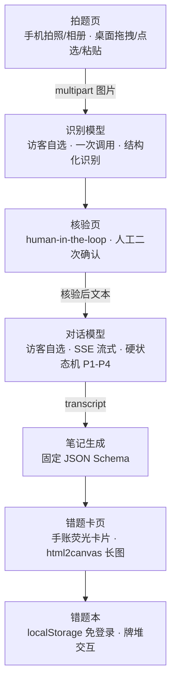

# MistakeCoach · 让每道错题都有交代

面向初高中学生的 AI 错题教练 H5：拍下做错的题（连同错误作答）→ AI 苏格拉底式对话还原思路、定位错因 → 自动生成结构化错题卡 → 长图分享、沉淀错题本。

> 教"为什么错"，而不是只教"怎么对"。

## 架构



## 核心亮点

1. **多模型分工**：视觉模型只做识别（一次调用），文本模型做对话与笔记生成——成本极低且各取所长。
2. **错因靠对话"钓"**：引导模式不直接给答案，硬状态机（还原思路 → 定位错因 → 提示梯度 L1-L4 → 确认理解）驱动对话；状态走消息末尾保持前缀稳定，命中 LLM 缓存（成本约为未命中的 1/10）。
3. **固定 JSON Schema 契约**：错题卡由 AI 按固定 Schema 输出，前端按 Schema 稳定渲染长图；错因分析强制引用学生原话作为证据。
4. **AI + 人工双兜底**：识别后强制进入核验页（human-in-the-loop）；AI 计算与卷面批改矛盾时会自检并温和指出，不盲从权威答案。
5. **访客自带 Key（BYOK）**：公网演示不烧开发者额度——识别与对话模型均可自选（智谱 GLM·免费 / DeepSeek / OpenAI / Claude / Gemini / 自定义，全部统一走 OpenAI 兼容通道，后端只实现一条调用链）；Key 与模型配置仅存本机 localStorage，随请求使用不落库，**服务端不内置任何 Key**。

## 技术栈

| 层 | 选型 |
|---|---|
| 前端 | Vue 3 + Vite + Vant 4 + vue-router · KaTeX 公式渲染 · html2canvas 长图导出 |
| 后端 | Python FastAPI · SSE 流式转发 · 静态托管前端构建产物 |
| 识别 | 访客自选（默认智谱 GLM-4V-Flash，免费），6 供应商可切 |
| 对话/笔记 | 访客自选（默认 DeepSeek Chat），与识别同一条 OpenAI 兼容通道 |
| 存储 | 免登录 + localStorage（错题卡、对话草稿、访客 Key） |

## 本地运行

```bash
# 1.（可选）覆盖各供应商默认模型名——无需配置任何 Key
cd backend
copy .env.example .env    # 仅有 ZHIPU_MODEL 等模型名覆盖项，可全部留空

# 2. 启动后端（8001）
pip install -r requirements.txt
python -m uvicorn main:app --port 8001

# 3. 启动前端（5173，已代理 /api 到 8001）
cd ../frontend
npm install
npm run dev
```

> 模型与 Key 在应用「设置页」配置（存浏览器 localStorage，见下方 BYOK 说明）。

## 部署（Render 免费版）

单服务部署：FastAPI 同时托管前端构建产物，见 [Dockerfile](Dockerfile)。

1. 代码推送到 GitHub（本仓库直接 push 即可）
2. [Render](https://render.com) 注册 → **New Web Service** → 连接 GitHub 仓库
3. Runtime 选 **Docker**（自动读取 Dockerfile），Region 选 Singapore（离国内近）
4. Create → 自动构建部署，得到 `https://<名字>.onrender.com` 公网链接

> **无需配置任何模型 Key 环境变量**：本服务不内置 Key（纯 BYOK），访客在应用「设置页」选模型并填自己的 Key——识别与对话均可选智谱 GLM·免费 / DeepSeek / OpenAI / Claude / Gemini / 自定义（OpenAI 兼容接口）。

> 免费版 15 分钟无访问会休眠：演示前先自己打开页面预热一次（首次加载约 50 秒）。

## 明确不做（后续规划）

- 用户账号体系 / 手机号登录
- 艾宾浩斯复习提醒、学情统计报表
- 错题批量导入、手写 OCR 深度优化
- AI 可视化教学（函数图像 / 几何示意图 / 统计图，已列入待办池）
